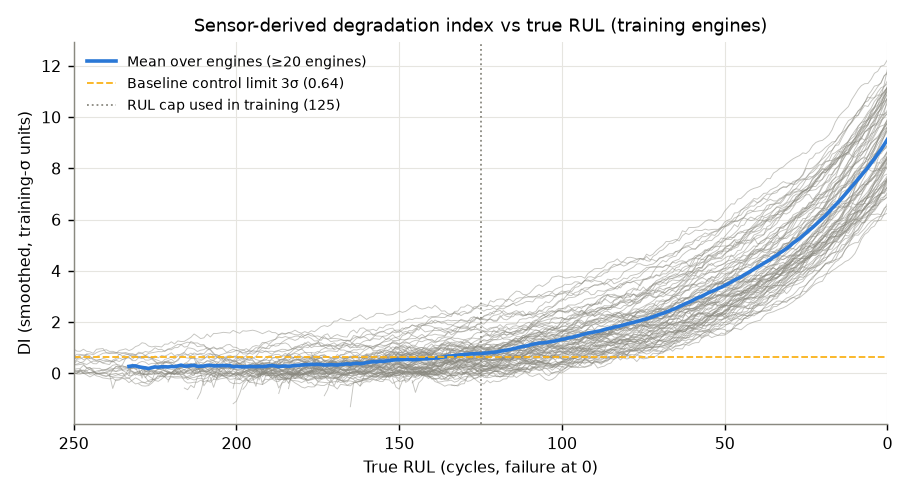
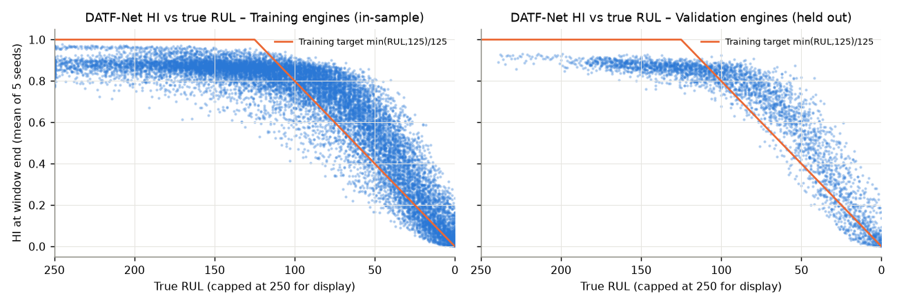
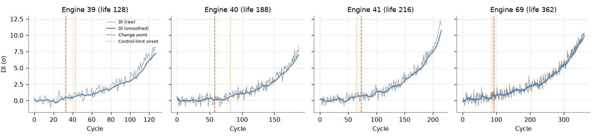
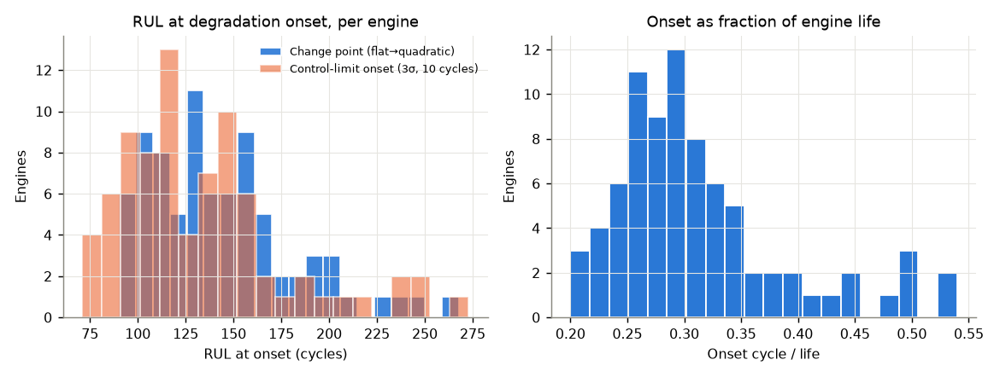
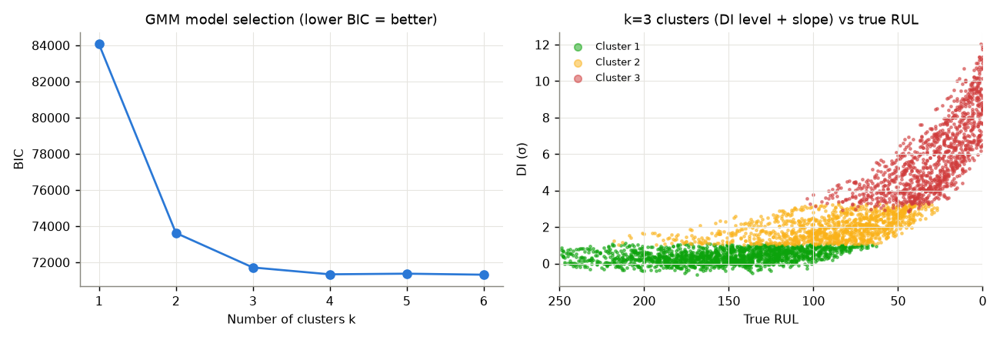
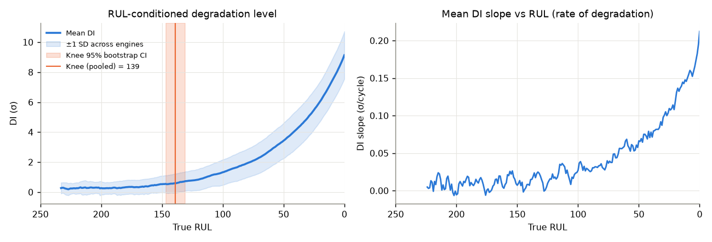

# Data-driven health-state thresholds — analysis (NASA C-MAPSS FD001)

**Status:** analysis and methodology proposal only. No model, pipeline, dashboard, API, checkpoint, scaler,
prediction file or experiment result was changed. Nothing here has been implemented.

**Data use:** thresholds were *discovered* on the **80 training engines** of the existing split. The **20 validation
engines** (held out from model training) were used only to check how rules frozen on the training engines behave.
The **official test set was not loaded.**

Reproduce: `.\.venv\Scripts\python.exe outputs\health_threshold_analysis\reproduce_analysis.py`
(writes only into this folder; numbers below come from `analysis_results.json` and `engine_level_summary.csv`).

---

## 1. Project files inspected (read-only)

| Purpose | File |
|---|---|
| Dataset | `data/raw/train_FD001.txt` (test/RUL files not used) |
| Loading, RUL labels, 125-cycle cap, windows, scaler | `src/data/load_data.py`, `src/data/preprocess.py`, `data/processed/preprocessor.joblib` |
| Engine baseline (first 10 cycles), HI target | `src/data/degradation.py` |
| DATF-Net model, training, experiments | `src/models/datf_net.py`, `src/train_datf.py`, `src/experiments.py` |
| DATF-Net checkpoints (inference only) | `models/checkpoints/datf/final/datf_full_seed{42..46}.pt` |
| Existing HI outputs | none saved per cycle; only aggregate diagnostics in `outputs/experiments/final/datf_full/*/run.json` |
| Current threshold logic | `src/config.py` (`WARNING_RUL = 50`, `CRITICAL_RUL = 25`), `src/predict.py` (`health_status`), `backend/main.py` (`/health` returns the thresholds), `dashboard/app.py`, `dashboard/components.py` |

## 2. Data findings (80 training engines)

* Lifetimes: 128–362 cycles (median 199, IQR 180–232, SD 49). **40 % of all training cycles have true RUL ≥ 125**,
  i.e. sit on the capped plateau of the training target.
* 10 of 15 active sensors (2, 3, 4, 7, 11, 12, 15, 17, 20, 21) trend in the same direction in **100 %** of engines
  (engine-level correlation with elapsed cycles |r| > 0.5); their late-life deviation from the engine's own
  first-10-cycle baseline is 3.8–7.7× the early-life noise.
* The other 5 are less consistent: sensor_6 is essentially noise (signal/noise 0.3); sensors 9 and 14 (core speed)
  trend consistently in only 55–59 % of engines; sensors 8 and 13 in 80–84 %.
* **Degradation index (DI):** the first principal component of the pooled baseline deviations explains **54.5 %** of
  their variance; its weights are almost equal across the 10 consistent sensors (|w| 0.26–0.30), with lower weight
  on sensor_6 (0.07) and sensors 9/14 (0.13–0.17). The DI uses no RUL labels and no model (orientation fixed by
  elapsed cycles only).

## 3. Health-indicator (DATF-Net HI) findings

Inference with the 5 saved DATF-Net checkpoints (mean over seeds), HI at the last cycle of every window.

| | Training engines (in-sample) | Validation engines (held out) |
|---|---|---|
| Correlation with capped RUL | 0.91 | 0.92 |
| HI when true RUL ≥ 125 | median 0.87 (q10–q90 0.81–0.92) | median 0.88 (0.84–0.91) |
| HI when true RUL 26–50 | median 0.41 (0.21–0.61) | median 0.42 (0.22–0.61) |
| HI when true RUL ≤ 10 | median 0.07 (0.02–0.20) | median 0.05 (0.01–0.19) |
| Share of cycle-to-cycle steps that *increase* | 46 % | 46 % |
| Mean |step| vs true per-cycle decrease | 0.041 vs 0.008 | 0.041 vs 0.008 |

* The only visible "region" in the HI is a **plateau (~0.87) followed by a decline**. That plateau exists because
  the HI target was capped at RUL 125 — it is imposed by the training target, not discovered.
* Across the decline there is **no gap or density minimum** separating a "degrading" from a "near-failure" region
  (histogram in `analysis_results.json`; plot 08). HI values for true RUL 26–50 span 0.2–0.6.
* The HI is **not monotone** per engine (46 % of steps increase; step noise ≈ 5× the true per-cycle change) and never
  reaches its target value 1.0 on the plateau.

## 4. Sensor degradation findings

* Per engine, the DI is flat (noise only) for a period and then rises smoothly and **with increasing speed** until
  failure (plots 02, 03, 05). Sign-aligned per-sensor curves show the same shape for all consistent sensors.
* DI at failure varies by engine: 6.2–12.2 σ (training), 6.6–11.9 σ (validation).
* Early-life noise of the smoothed DI (10-cycle causal mean, cycles 10–30): σ_w = 0.214 σ.

## 5. Change-point findings (Method B)

Per engine, on the raw DI, models compared by BIC:

| Model | Engines where best (of 80) |
|---|---|
| flat (no change) | 0 |
| flat → linear | 0 |
| flat → quadratic (one change point) | 10 |
| flat → slope → steeper slope (two change points) | **70** (ΔBIC < −10 vs one change point in **49**) |

**Onset of degradation (first change point) is detected in all 80 training engines**, but its position varies
strongly between engines:

| Onset estimate (training) | RUL at onset: median | IQR | range |
|---|---|---|---|
| Change point (flat → quadratic) | 136 | 110–162 | 90–268 |
| Control limit (DI > 3σ_w for 10 cycles) | 122 (95 % CI of median 113–136) | 102–151 | 71–273 |

Validation engines (rule frozen): control-limit onset detected in **20/20**, median RUL 118 (IQR 105–126).

**Acceleration (second change point)**, where it is statistically supported (49/80 training, 11/20 validation):
RUL median **45** (95 % CI of median 39–51), IQR 35–63, range 25–99 (training); validation median 47.
In the other 31 training engines the curve is fitted equally well by one smooth quadratic rise — **no distinct
second transition.** No transition around RUL 25 was found.

## 6. Clustering findings (Method C)

GMM on per-cycle features (smoothed DI level, 10-cycle DI slope), numpy EM, k = 1–6:

* BIC falls steeply to k = 3, then flattens (k = 4–6 within 0.1 %): **no clear number of natural clusters**.
* The k = 3 clusters are horizontal slices of one continuous curve (plot 07). Their RUL ranges overlap heavily
  (cluster 1: 63–352, cluster 2: 25–231, cluster 3: 0–113).
* Only **23/80** engines pass through the clusters in order without switching back; median 4 label switches per engine.

Conclusion: clustering partitions a continuum; it does not reveal discrete health states in FD001.

## 7. RUL-conditioned stages (Method D)

* Pooled mean DI vs true RUL has one knee at **RUL 139** (engine-bootstrap 95 % CI **131–147**, 500 resamples);
  below it the mean rises with increasing slope (plot 06).
* The knee is tight **only because it is pooled.** Individual engines start degrading between RUL 71 and 273, and the
  RUL at onset correlates **0.89 with engine lifetime** (long-lived engines degrade slowly and start earlier in RUL
  terms). A single global RUL boundary for "degradation has started" is therefore **not defensible per engine.**
* Independent observation: the sensor-only onset (median 122–136, pooled knee 139) is consistent with the RUL cap
  of 125 used in training — this supports the cap; it does not validate the HI.

## 8. Engine-to-engine consistency

| Transition | Supported in | Engine spread (RUL) | Global RUL threshold justified? |
|---|---|---|---|
| Healthy → Degrading (onset) | 80/80 train, 20/20 validation | IQR 102–151, range 71–273, r = 0.89 with lifetime | **No** — use an engine-relative (sensor/baseline) rule |
| Degrading → accelerated / near failure | 49/80 train (61 %), 11/20 validation | IQR 35–63, range 25–99 | **Population-level only** (median 45) |
| Third boundary at RUL 25 | not found | – | **No evidence** |

## 9. Data-leakage check

* All boundaries, PCA weights, noise level and the failure-level quantiles were computed from the 80 training
  engines only. The 20 validation engines were only used to evaluate frozen rules. The test files were not read.
* Scaling uses the saved training scaler (read-only). The DI's engine baseline uses only the engine's own first
  10 cycles (past data).
* DATF-Net HI on training engines is **in-sample** (the model was trained on them); only its validation-engine
  behaviour is an out-of-sample check.
* The retrospective change-point fits use each training engine's full life (future relative to any cycle). That is
  acceptable for *calibrating* boundaries on training data; it cannot be used to classify a running engine online.

## 10. Circularity — what comes from where

| Quantity | Source | Independent of the RUL target? |
|---|---|---|
| DI, its baseline, noise level, onset and acceleration shape | sensors only (unsupervised) | **Yes** |
| RUL value at which a sensor transition happens | sensor transition + training labels | labels used only to *measure* it |
| DATF-Net HI | model trained on `min(RUL,125)/125` | **No** — HI is scaled predicted RUL |
| Predicted RUL, MC-dropout uncertainty | model output | No |
| Current Normal/Warning/Critical | predicted RUL vs fixed 50/25 | No (manual cut-offs) |

* An HI threshold is exactly an RUL threshold (HI × 125). HI regions cannot *prove* a health state.
* The HI plateau is created by the RUL cap in the target; it is not evidence of a natural "healthy" regime. The
  sensor-only onset analysis is the independent evidence.

## 11. Possible data-driven methods — factual comparison

| | A. HI quantiles | B. Change point / control limit on DI | C. Clustering | D. RUL-conditioned knee |
|---|---|---|---|---|
| Data-driven | yes | yes | yes | yes |
| Free of arbitrary choices | quantile levels arbitrary | k=3σ (SPC convention), window 10, persistence 10 — sensitivity: median onset 108–134 | k and features chosen; BIC gives no clear k | fit form chosen |
| Leakage | none if trained on train engines | none | none | none |
| Engine robustness | HI noisy, non-monotone | onset found in 100 % of engines; engine-relative | 23/80 engines monotone | pooled; engine spread large |
| Circularity | **circular** (HI = RUL/125) | independent of labels and model | independent | uses labels to locate transitions (calibration only) |
| Online use | yes | onset: yes (causal); acceleration: retrospective only | yes, but unstable | only via predicted RUL |
| Interpretability / viva | easy but weak claim | "sustained departure from the engine's own healthy baseline" | hard to justify | "average transition at RUL x" |
| Dashboard | trivial | needs engine history (available via API) | – | trivial (predicted RUL) |

## 12. Recommended methodology (not implemented)

Three states with explicit, separate evidence:

| State | Evidence | Boundary (frozen from training engines) |
|---|---|---|
| **Healthy** | sensors: no sustained departure from the engine's own baseline | DI_s ≤ L1 |
| **Degrading** | sensors: sustained departure (latched once reached) | DI_s > L1 for 10 consecutive cycles |
| **Near failure** (accelerated degradation) | model: predicted RUL at or below the typical acceleration point | predicted RUL ≤ R_acc |

* The Healthy/Degrading boundary is **engine-adaptive and model-independent** (relative to each engine's own first
  10 cycles). It replaces the unsupported global "RUL > 50 = Normal".
* The Near-failure boundary R_acc is a **population-level** value measured from sensor behaviour on training engines
  (median RUL at the acceleration change point = 45, 95 % CI 39–51), applied to the model's predicted RUL.
* The manual "Critical ≤ 25" has no support in the data and would be dropped (or kept only as a stated policy).
* A DI failure-level quantile (L2 = 7.18 σ for q = 0.10) was evaluated as a sensor-only near-failure alarm and is
  **not recommended as the primary rule**: median lead time only 11–12 cycles, and 10–15 % of engines never reach
  it (8/80 training, 3/20 validation) — see plot 09.

## 13. Exact algorithm

**Calibration (once, training engines only; then frozen to a JSON artifact):**
1. x_t = scaled 15 sensors (saved training scaler). b_e = mean of the engine's first 10 cycles. d_t = x_t − b_e.
2. w = first principal component of all training d_t; sign chosen so DI increases with elapsed cycles.
3. DI_t = w·d_t; DI_s,t = mean(DI_{t−9..t}) (causal).
4. σ_w = SD of DI_s over cycles 10–30 of all training engines; **L1 = 3 σ_w** (currently 0.64).
5. For every training engine fit flat → slope → steeper slope; keep engines with ΔBIC < −10 over a single smooth
   rise; **R_acc = median RUL at the second breakpoint** (currently 45; report its bootstrap CI).

**Classifying a new engine at cycle t:**
1. Needs ≥ 10 cycles of history (baseline). Before that: state "Insufficient history" (no guess).
2. Degrading flag = DI_s > L1 for 10 consecutive cycles at any time so far (latched).
3. p = predicted RUL, u = MC-dropout SD. Near failure if p ≤ R_acc.
4. State = Near failure if (3); else Degrading if (2); else Healthy.
5. **Near a boundary:** if |p − R_acc| ≤ u, show the state with a "boundary / uncertain" marker.
   If the model says Near failure but the sensors have not left the baseline (or the reverse), show the more severe
   state **and** a "model–sensor disagreement" note instead of hiding it.

## 14. Validation plan

1. **Training (80 engines):** discover and freeze w, σ_w, L1, R_acc. Report sensitivity to k ∈ {2.5, 3, 3.5},
   window ∈ {5, 10, 20}, persistence ∈ {5, 10} (already done for the onset: median 108–134).
2. **Stability:** 5-fold cross-validation over training engines (re-derive the boundaries on 4/5, evaluate on 1/5)
   and engine bootstrap for CIs of L1 and R_acc.
3. **Validation (20 engines):** onset detection rate (currently 20/20), no onset in the first 30 cycles, distribution
   of RUL at onset vs training, stability after latching; Near failure: per-window confusion of state from
   predicted RUL vs from true RUL, and per-engine lead time (first cycle flagged vs true failure).
4. **Test (100 engines) — once, after approval, no tuning:** state at the last recorded cycle from (a) predicted RUL
   and (b) DI, compared with the state implied by the true RUL label.

## 15. Dashboard integration plan (not implemented)

* Today: `health_status(rul)` → Normal if RUL > 50, Warning if 25 < RUL ≤ 50, Critical if RUL ≤ 25
  (e.g. RUL 41 → Warning).
* Proposed: backend computes DI from the engine history it already has, returns additive fields
  (`sensor_state`, `di`, `di_limit`, `onset_cycle`, `data_driven_state`, `state_basis`); thresholds loaded from a
  frozen JSON produced by a training-only calibration script. Example: RUL 41 with DI past L1 → **Near failure**
  (41 ≤ R_acc 45), basis "predicted RUL below training acceleration point; sensors confirm degradation".
* UI: show the state with its basis (sensor evidence vs model), the boundary/uncertainty marker, and any
  model–sensor disagreement. Existing API fields stay unchanged.

## 16. What should NOT be claimed

* That HI thresholds independently identify health states (HI is trained to be RUL/125).
* That FD001 contains three natural, discrete health states (clusters partition a continuum; no transition at 25).
* That a single RUL value marks the start of degradation for every engine (onset spans RUL 71–273).
* That R_acc ≈ 45 applies to each engine (population median; supported in 61 % of engines, spread 25–99).
* That the resulting states are validated safety limits.
* That the agreement between R_acc ≈ 45 and the old "50" validates the manual threshold — it is a coincidence
  worth mentioning, not a confirmation.

## 17. Files in this folder

`reproduce_analysis.py` (analysis script), `analysis_report.md` (this report), `analysis_results.json`,
`engine_level_summary.csv`, `sensor_trend_summary.csv`, `rul_conditioned_degradation.csv`, and plots
`01_lifetimes.png` … `09_candidate_rule_validation.png`.
