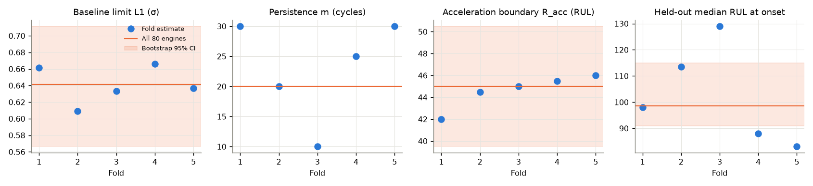
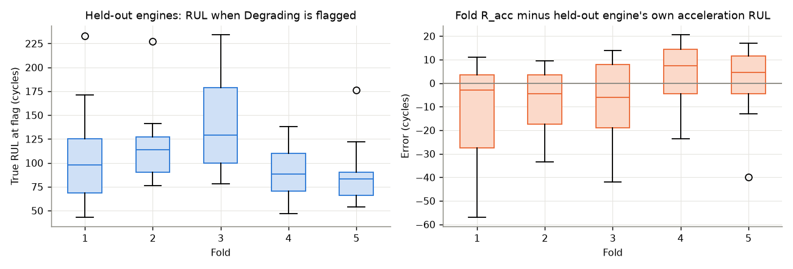
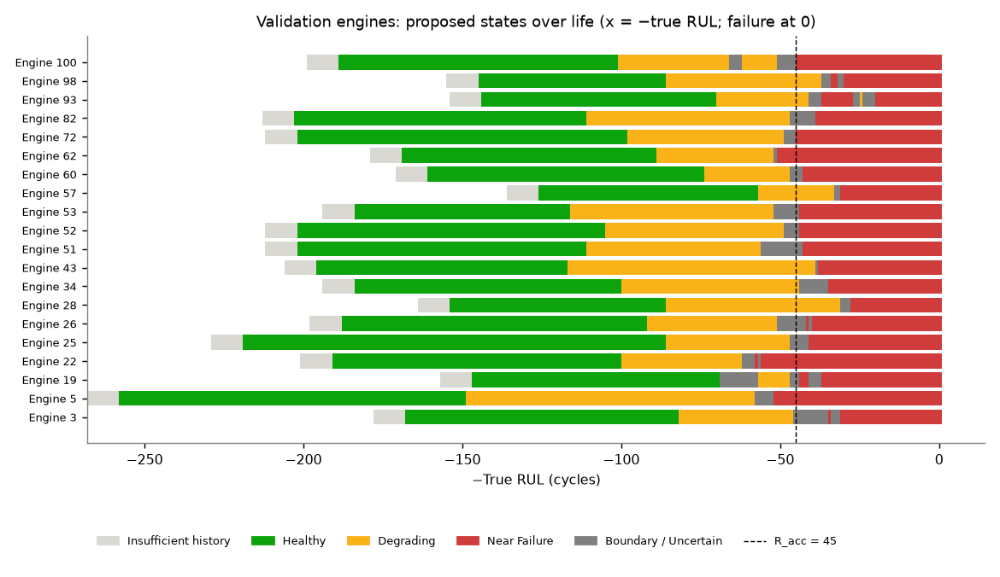
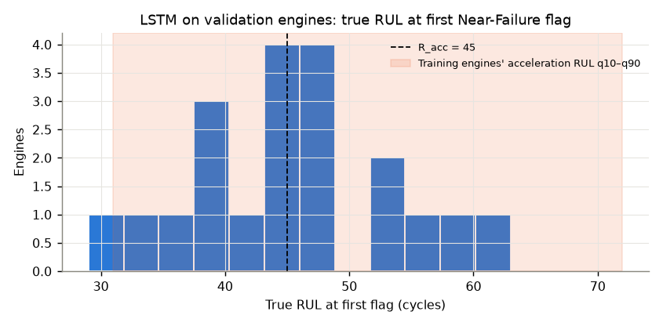
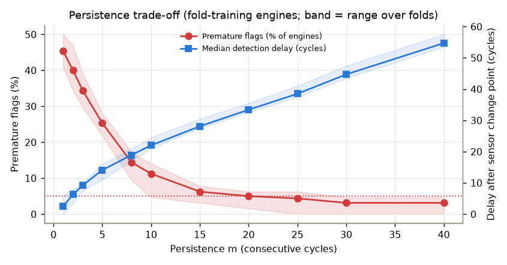

# Validation of the data-driven health-state methodology (FD001)

**Status:** validation only. No model, checkpoint, scaler, prediction file, experiment result, API or dashboard
was changed; nothing was retrained. The official test set was not loaded.
Companion to `analysis_report.md` (not modified). Reproduce:
`.\.venv\Scripts\python.exe outputs\health_threshold_analysis\cv_validation.py` (writes only `cv_*` files and
plots 10–14). Numbers below come from `cv_results.json`, `cv_fold_summary.csv`, `cv_heldout_engines.csv`,
`cv_validation_engine_states.csv`.

## State definitions under test

| State | Rule |
|---|---|
| Healthy | smoothed sensor degradation index (DI_s) has not exceeded the engine-relative limit L1 for m consecutive cycles |
| Degrading | DI_s > L1 for m consecutive cycles (declared at the end of the run, then latched) |
| Near Failure | model-predicted RUL ≤ R_acc (fleet-level acceleration boundary) |
| Boundary / Uncertain | \|predicted RUL − R_acc\| ≤ MC-dropout uncertainty, **or** model says Near Failure while sensors are still Healthy |

The earlier "Critical ≤ 25" boundary is **removed**: FD001 shows no transition at 25. If an operational cut-off at
25 cycles is wanted it must be presented as an **optional policy threshold, not a finding from FD001**.

**Correction to the first analysis:** `analysis_report.md` dated each Degrading onset to the *start* of the
persistence run. An online system can only declare the state at the *end* of the run (m − 1 cycles later). This
validation uses declaration time throughout; onset RULs are therefore lower than in the first report.

## 1. Cross-validation methodology

* 80 training engines split into **5 engine-level folds** (16 engines each, seed 2024). Each fold's 64 training
  engines re-derive, independently: the PCA weights of the DI, the early-life noise σ_w, **L1 = 3σ_w**, the
  persistence m, and **R_acc** (median RUL at the statistically supported acceleration change point).
* Persistence selection rule (stated policy tolerance): smallest m in {1,2,3,5,8,10,15,20,25,30,40} for which ≤ 5 %
  of fold-training engines are declared Degrading before their own sensor change point; if none qualify, the
  smallest m within 1 point of the lowest rate.
* The 16 held-out engines are evaluated with the frozen fold parameters. Reference points are sensor-only
  retrospective change points (flat → quadratic onset; flat → slope → steeper slope acceleration).
* **Engine bootstrap** (2,000 resamples of the 80 engines) for confidence intervals.
* **Near Failure needs model predictions.** Predictions on the 80 training engines are in-sample for the existing
  models, so the model-based rule is evaluated on the **20 validation engines** with the deployed LSTM baseline
  (primary) and DATF-Net (mean of 5 seeds, secondary). Inference only — no retraining.

## 2. Fold-level results

| Fold | PCA cosine vs all 80 | L1 | m selected | R_acc | Held-out detected | Declared before change point (>20 cycles before) | Held-out median RUL at declaration |
|---|---|---|---|---|---|---|---|
| 1 | 0.99994 | 0.661 | 30 | 42.0 | 16/16 | 0 (0) | 98 |
| 2 | 0.99990 | 0.609 | 20 | 44.5 | 16/16 | 1 (1) | 113.5 |
| 3 | 0.99873 | 0.633 | 10 | 45.0 | 16/16 | 6 (3) | 129 |
| 4 | 0.99995 | 0.666 | 25 | 45.5 | 16/16 | 0 (0) | 88 |
| 5 | 0.99954 | 0.636 | 30 | 46.0 | 16/16 | 0 (0) | 83 |
| All 80 | – | 0.641 | 20 | 45.0 | – | – | – |

## 3. Parameter stability

* **DI weights:** cosine similarity to the all-engine weights ≥ 0.9987 in every fold — stable.
* **Sensor-index boundary L1:** 0.609–0.666 across folds (all-engine 0.641). **Stable.**
* **Acceleration boundary R_acc:** 42.0–46.0 across folds (all-engine 45.0). **Stable at fleet level.**
* **Persistence m:** the selection rule picked **10, 20, 25, 30, 30** — **not stable.** The premature-flag curve is
  flat between m = 15 and 30 (6.2 % → 3.8 %), so small sample changes move the choice. Persistence is a trade-off,
  not a quantity the data determines (section 8).
* **Degradation onset:** varies with m, not with L1. When m is held fixed, fold vs all-engine parameters move an
  engine's declaration by median 0 cycles (90th percentile 2); with fold-selected m the shift is median 10, max 46.

## 4. Confidence intervals (engine bootstrap, 2,000 resamples)

| Quantity | Estimate | 95 % CI |
|---|---|---|
| L1 (σ units) | 0.641 | 0.566 – 0.712 |
| R_acc (RUL cycles) | 45.0 | 39.5 – 50.5 |
| Median RUL when Degrading is declared (m = 20) | 98.5 (held-out, fold params) | 91 – 115 |

## 5. Engine-level consistency

* Degrading is declared in **80/80 held-out engines**, never within the first 30 cycles.
* RUL at declaration (fold-selected m): median 97.5, range 43–234 — the engine-to-engine spread already found in
  the analysis (slow-degrading engines start earlier in RUL terms). This is why the Healthy/Degrading boundary is
  engine-relative (sensor-based), not a global RUL value.
* After declaration, DI_s stays above L1 in essentially all cycles (max 2.8 % of cycles below; median 0 %).
* Acceleration point: statistically supported in 49/80 engines (61 %). For those, R_acc from the other folds
  differs from the engine's own acceleration RUL by median |11| cycles (90th percentile 30, max 57).
  **R_acc is a fleet-level boundary, not an individual-engine failure threshold.**

## 6. Failure / near-failure detection behaviour (20 validation engines)

| | LSTM baseline (deployed) | DATF-Net (5-seed mean) |
|---|---|---|
| Engines never flagged Near Failure before failure | **0 / 20** | **0 / 20** |
| True RUL at first Near-Failure flag: median (range) | 45 (29 – 63) | 47 (31 – 61) |
| Flagged too early (true RUL > 72, training q90 of acceleration RUL) | 0 | 0 |
| Flagged late (true RUL < 31, training q10) | 1 | 0 |
| Returns from Near Failure to a lower state (unlatched), per engine | mean 0.25 | mean 0.7 |
| Cycle-level agreement with "true RUL ≤ 45": precision / recall | 0.94 / 0.93 | 0.94 / 0.93 |

With the five fold-specific R_acc values (42–46) the LSTM's median lead is 43–46.5 cycles, 0 engines missed and
1 late in every case — the rule is insensitive to R_acc within its uncertainty.

Combined states on the validation engines (all-engine parameters, m = 20) — cycles per true-RUL band:

| True RUL band | Healthy | Degrading | Near Failure | Boundary / Uncertain |
|---|---|---|---|---|
| ≥ 125 | 1127 | 25 | 0 | 0 |
| 46 – 124 | 606 | 874 | 25 | 75 |
| 0 – 45 | 0 | 46 | 806 | 68 |

Boundary / Uncertain: 143 of 3,652 classified cycles (3.9 %); **model–sensor disagreement: 0 cycles** (the model
never predicted RUL ≤ 45 while the sensors were still at baseline). Degrading is latched, so sensor states never
move backwards. Near Failure is not latched: in 5 of 20 engines the LSTM's predicted RUL crossed back above 45 once
(through the Boundary / Uncertain state). An implementation should either latch Near Failure or keep this
oscillation visible as Boundary / Uncertain — a design decision, not a data finding.

## 7. Lead-time analysis

* **Degrading** (held-out, declaration time): median 98.5 cycles before failure with m = 20 (112.5 with m = 10);
  minimum 52 (m = 20) — so with m ≤ 20 every held-out engine is declared Degrading before it reaches the fleet
  Near-Failure boundary. With m = 30 the minimum drops to 42 cycles, i.e. some engines would be declared Degrading
  only after they have already passed R_acc.
* **Near Failure** (validation engines, LSTM): first flag median 45 cycles before failure (29–63). By construction
  this tracks R_acc; its spread reflects the model's RUL error, not an engine-specific failure threshold.

## 8. False alarm / missed detection analysis

**Degrading — persistence trade-off** (all 80 training engines; declared before the engine's own sensor change
point / median delay after it):

| m | 1 | 5 | 10 | 15 | 20 | 25 | 30 | 40 |
|---|---|---|---|---|---|---|---|---|
| Declared before change point | 45.0 % | 25.0 % | 11.2 % | 6.2 % | 5.0 % | 5.0 % | 3.8 % | 3.8 % |
| Median delay (cycles) | 2 | 14 | 21.5 | 28 | 33 | 39 | 45 | 55 |

Held-out engines (fold parameters): m = 10 → 9/80 declared before the change point (4 by more than 20 cycles),
median delay 22; m = 20 → 4/80 (3), delay 33.5; m = 30 → 3/80 (1), delay 44. Missed detections: 0/80 for every m.

"Before the change point" is measured against a *retrospective estimate* of onset; flags a few cycles early are
within that estimate's uncertainty. The stricter count (more than 20 cycles early) is the better false-alarm proxy.

**Near Failure:** missed 0/20 engines; early 0/20; late 1/20 (LSTM) and 0/20 (DATF-Net).

## 9. Limitations

* **Near Failure was validated on 20 engines only**, and those engines were used for early stopping when the models
  were trained, so they are not fully independent of model selection. A fully cross-validated evaluation of the
  model-based rule would require retraining the models per fold (out-of-fold predictions for all 80 engines). That
  was **not** done; it needs your approval.
* The premature-flag reference is itself a retrospective change-point estimate.
* R_acc is supported in 61 % of engines; the remaining engines show one smooth rise without a distinct acceleration.
* Persistence cannot be fixed from the data alone; it is a policy choice between earlier warning and fewer early
  declarations.
* FD001 has one operating condition and one fault mode; parameters are not expected to transfer to FD002–FD004
  without re-derivation.
* The test set has not been used; the final one-time test evaluation is still pending.

## 10. Final recommendation

**The methodology is stable enough to implement**, with persistence treated as a documented policy parameter:

| Parameter | Value to freeze (all 80 training engines) | Evidence of stability |
|---|---|---|
| DI weights w | PCA on training baseline deviations | cosine ≥ 0.9987 across folds |
| L1 | 0.641 σ | folds 0.609–0.666; CI 0.566–0.712 |
| R_acc | 45 cycles | folds 42–46; CI 39.5–50.5; Near-Failure results unchanged across that range |
| m (policy) | **20 recommended** (10 acceptable if earlier warning is preferred) | 5 % declared before change point, median delay 33, every held-out engine declared before R_acc; m = 10: 11 % and 22 cycles; m ≥ 30 can declare too late |

What must **not** be claimed: that FD001 has three naturally discrete classes; that RUL = 45 is an individual-engine
failure threshold; that the sensor index independently predicts RUL (it only detects departure from the baseline);
that the HI proves health states; that 25 is a data-derived boundary.

Awaiting approval before any API or dashboard change. Open decisions: (1) persistence m = 20 or 10;
(2) whether to run the out-of-fold retraining needed for a fully cross-validated Near-Failure evaluation.
