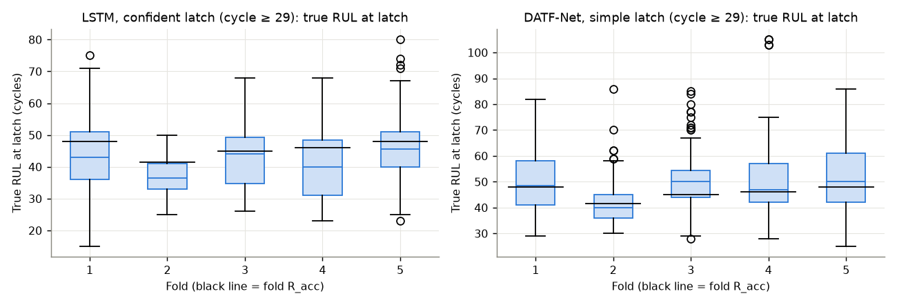
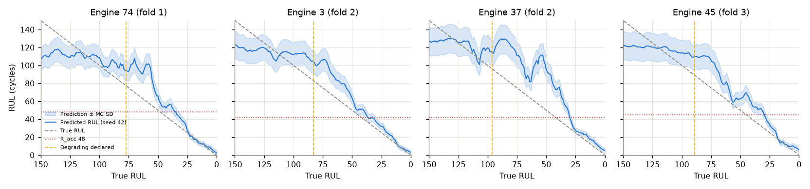

# Cross-validated Near-Failure evaluation (FD001) — validation only

**These are VALIDATION-ONLY models.** They were trained solely to test the Near-Failure methodology and are stored
in `outputs/health_threshold_analysis/near_failure_cv/models/` (checkpoint metadata `validation_only: true`). They
are **not** the project's final models: the production LSTM (`models/checkpoints/lstm_best.pt`), the DATF-Net
experiment checkpoints and all existing results and test evaluations are untouched.

Reproduce: `.\.venv\Scripts\python.exe outputs\health_threshold_analysis\near_failure_cv\near_failure_cv.py`
(skips training when a fold model already exists). Numbers: `near_failure_cv_results.json`,
`near_failure_cv_engine_records.csv` (one row per fold × model × seed × held-out engine), `near_failure_cv_folds.csv`.

## Approved state definitions (as evaluated)

| State | Rule |
|---|---|
| Healthy | sensor index within the engine-relative limit L1 |
| Degrading | sensor index > L1 for **m = 20** consecutive cycles (latched). m = 20 is an **implementation policy choice** based on the persistence trade-off in `cv_validation_report.md`, not a naturally discovered FD001 boundary |
| Near Failure | predicted RUL reaches the fleet-level acceleration boundary **R_acc = 45**; **latched** once validly reached; the current predicted RUL is always shown |
| Boundary / Uncertain | current prediction within its MC-dropout uncertainty of R_acc |
| Disagreement | shown explicitly (e.g. Near Failure latched while sensors are still Healthy) — never silently resolved |

The former "Critical ≤ 25" threshold is removed from the methodology.

## 1. Protocol

* **Engines:** the 100 engines of `train_FD001.txt`, 5 folds × 20 held-out engines (seed 2025). The test files were
  never used by the cross-validation (see the disclosure in section 8).
* **Per fold:** the 80 non-held-out engines are split into 64 inner-training and 16 inner-validation engines.
  A **new scaler** is fitted on the 64 inner-training engines (in memory; the saved preprocessor is not used, because
  it was fitted on engines that are held out in some folds). Models are trained on the 64 and **early-stopped on the
  16 inner-validation engines**. Sensor parameters (index weights, L1, R_acc) are re-derived on the 80 non-held-out
  engines. Held-out engines are touched only for evaluation.
* **Models:** the deployed LSTM architecture (primary; per-cycle predictions with front-padded early windows exactly
  as the dashboard gets them, and MC-dropout uncertainty computed as in production — verified identical to
  `Predictor` to within 0.0004 cycles on 316 training-file windows) and DATF-Net (secondary; point predictions from
  the first full window). 5 seeds each → 50 validation-only models; training conditions identical to the existing
  pipeline.
* **Latch triggers compared:** *simple* (predicted RUL ≤ R_acc), *confident* (predicted RUL + uncertainty ≤ R_acc,
  i.e. outside the Boundary band), and *first alert* (predicted RUL − uncertainty ≤ R_acc, i.e. entry into the
  Boundary band). Each is evaluated with the latch allowed from cycle 0, from cycle 10 (end of the baseline /
  "Insufficient history") and from cycle 29 (first full 30-cycle window).
* **Definitions:** *early* = true RUL at latch above the fold-training q90 of sensor acceleration RULs (≈ 70–76);
  *late or missed* = below the fold-training q10 (≈ 31) or never latched. Precision / recall are cycle-level for the
  latched state vs "true RUL ≤ R_acc". CIs: engine bootstrap (2,000 resamples of the 100 held-out engines, all seeds
  kept together).

## 2. Fold-level R_acc and sensor limit (re-derived per fold)

| Fold | R_acc | Engines with supported acceleration | L1 |
|---|---|---|---|
| 1 | 48.0 | 48/80 | 0.638 |
| 2 | 41.5 | 48/80 | 0.592 |
| 3 | 45.0 | 47/80 | 0.633 |
| 4 | 46.0 | 47/80 | 0.633 |
| 5 | 48.0 | 50/80 | 0.606 |

R_acc 41.5–48.0 (mean 45.7); L1 0.59–0.64 — consistent with the earlier estimates (45; 0.64).

## 3. Near-Failure results — LSTM (deployed architecture), latch allowed from cycle 29

| Trigger | Detected | True RUL at latch: median [95 % CI] (q10–q90) | Early [CI] | Late or missed [CI] | Precision [CI] | Recall [CI] |
|---|---|---|---|---|---|---|
| Simple (p ≤ 45) | 100 % | 44 [42–47] (33–61) | 2.4 % [0.4–5.2] | 8.4 % [4.0–13.2] | 0.912 [0.889–0.934] | 0.914 [0.893–0.933] |
| **Confident (p + u ≤ 45)** | 100 % | **41 [39–43]** (30–58) | **0.8 % [0.0–2.2]** | 14.0 % [8.2–20.2] | **0.938 [0.917–0.958]** | 0.873 [0.849–0.895] |
| First alert (p − u ≤ 45) | 100 % | 49 [47–51] (34–66) | 6.0 % [2.4–10.4] | **5.8 % [2.2–9.6]** | 0.866 [0.840–0.891] | **0.944 [0.927–0.961]** |

Per fold (confident trigger, mean over 5 seeds):

| Fold | R_acc | Median lead (seed range) | Early | Late / missed | Precision | Recall |
|---|---|---|---|---|---|---|
| 1 | 48.0 | 42.2 (39.5–45.0) | 1 % | 10 % | 0.925 | 0.860 |
| 2 | 41.5 | 36.8 (35.0–38.0) | 0 % | 16 % | 0.977 | 0.884 |
| 3 | 45.0 | 43.1 (39.5–46.5) | 0 % | 10 % | 0.935 | 0.890 |
| 4 | 46.0 | 39.6 (38.0–42.5) | 0 % | 27 % | 0.935 | 0.838 |
| 5 | 48.0 | 45.1 (42.5–48.0) | 3 % | 7 % | 0.926 | 0.894 |

**Every held-out engine was flagged before failure by every model and trigger.** DATF-Net (simple trigger, from
cycle 29): median 47 [45–50], early 6.6 %, late 4.6 %, precision 0.868, recall 0.935.

## 4. Important failure cases (LSTM, confident trigger from cycle 29; 5 seeds)

* **Late latches (13 engines, ≥ 3 of 5 seeds):** engines 3, 8, 24, 28, 37, 42, 45, 74, 77, 85, 87, 93, 98 latch at
  true RUL 23–34. The model over-estimates RUL in mid-life and crosses 45 only late (plot 16). For most of them the
  **first alert (Boundary / Uncertain) came earlier** — e.g. engine 74 at 27–47, engine 77 at 54–55 — so under the
  approved design the dashboard would already show Boundary / Uncertain before the latch.
* **Early latches (2 engines):** engine 92 (life 341) and engine 16 (life 209) latch at true RUL 64–80; long-lived
  engines degrade slowly and look "near failure" earlier by RUL. These are the only early latches once the latch is
  gated to cycle ≥ 29.
* **Degenerate start-of-life latches (without gating):** engine 91 (life 135) latched at true RUL 124–128 in 4/5
  seeds and engine 32 at RUL 190 in 2/5 seeds — within the first 10 cycles, where the LSTM sees windows padded by
  repeating the first reading, and **while the sensors were still Healthy**. Gating the latch to cycle ≥ 10 is not
  enough (engine 91 still latched at cycle 10); **gating to the first full window (cycle ≥ 29) removes all of them**.

## 5. Does latching create misleading behaviour?

| Latch rule (LSTM) | Engine-runs where the current prediction later rises confidently above 45 (p > 45 + u) after latching | Latched while sensors Healthy | Latest-possible early latch |
|---|---|---|---|
| Confident, from cycle 0 | 4.8 % | 1.2 % | true RUL 190 |
| Confident, from cycle 10 | 4.4 % | 0.8 % | 124 |
| **Confident, from cycle 29** | **3.6 % (128 cycles)** | **0.0 %** | **80** |
| Simple, from cycle 29 | 8.2 % (317 cycles) | 0.2 % | 92 |
| First alert, from cycle 29 | 24.8 % (883 cycles) | 1.0 % | 94 |

* Latching **can** mislead in two ways: (a) a latch triggered by an unreliable early prediction would hold Near
  Failure for the whole life — prevented by gating to cycle ≥ 29; (b) after latching, the current prediction may
  move back above the boundary (e.g. engine 19 latched at true RUL ≈ 61 in all 5 seeds, then its prediction rose).
  With the confident trigger this affects 3.6 % of engine-runs. **This is why the dashboard must keep showing the
  current predicted RUL next to the latched state and mark "latched — current prediction above boundary"** when
  p > 45 + u after the latch.
* Latching on the first alert or on the simple trigger contradicts the current prediction far more often
  (24.8 % / 8.2 %); do not latch on those.
* Unlatched, the LSTM's raw "p ≤ 45" crosses back above 45 in 0.28 transitions per engine on average (max 4) —
  the oscillation latching is meant to suppress.

## 6. Is RUL = 45 still defensible?

**Yes, as a fleet-level boundary:** re-derived independently in each fold it is 41.5–48.0; with out-of-fold models
every held-out engine is flagged before failure; the median true RUL at the confident latch is 41 (CI 39–43) and at
the first alert 49 (CI 47–51), bracketing 45. **It is not an individual-engine failure threshold:** per-engine
leads span 15–80 cycles and 13 of 100 engines are consistently flagged late because of model error.

## 7. Recommended Near-Failure policy for implementation (not implemented)

1. No health state before cycle 10 ("Insufficient history"); **no Near-Failure latch before cycle 29** (first full
   30-cycle window).
2. **Boundary / Uncertain** whenever |p − 45| ≤ u (MC-dropout SD). In practice this appears first (first alert:
   median 49 cycles before failure, 5.8 % late or missed).
3. **Latch Near Failure** at the first cycle ≥ 29 with p + u ≤ 45 (confident: median 41, 0.8 % early, 14 % late,
   precision 0.94).
4. After latching, always show the current p ± u; if p > 45 + u, show "latched — current prediction above boundary".
5. If Near Failure is latched (or p ≤ 45) while the sensor index is still Healthy, show a model–sensor
   disagreement. In this CV that combination did not occur once the latch was gated to cycle ≥ 29.

## 8. Limitations and disclosures

* Fold models are trained on 64 engines (production: 80), so these estimates are, if anything, slightly
  pessimistic about the production model.
* DATF-Net used λ values selected earlier on the original validation split, whose engines are held out in some
  folds here — a mild hyper-parameter leak for the secondary DATF-Net results only. The LSTM had no tuning.
* "Early" and "late" are defined with respect to the fold-training distribution of sensor acceleration points;
  other definitions would give different rates.
* FD001 only (one operating condition, one fault mode).
* **Disclosure:** while verifying that the batched uncertainty calculation matches production, I first ran the
  comparison on windows of **test engine 34**. That check compared two implementations of the same function; it was
  not used for any tuning, boundary choice or evaluation, and nothing was saved. I repeated the check on
  training-file engines 3 and 57 (identical point predictions; uncertainty within 0.0004 cycles), and that is the
  verification reported above. The test set was not used by the cross-validation itself.

## 9. What should not be claimed

* That RUL 45 is an individual-engine failure threshold (fleet-level acceleration boundary only).
* That FD001 has three naturally discrete classes, that the sensor index predicts RUL, or that the HI proves states.
* That m = 20 is a data-discovered constant (it is a policy choice).
* That these validation-only models are the project's final models.

## Files (all in this folder)

`near_failure_cv.py`, `near_failure_cv_report.md`, `near_failure_cv_results.json`,
`near_failure_cv_engine_records.csv`, `near_failure_cv_folds.csv`, `15_nfcv_lead_by_fold.png`,
`16_nfcv_failure_case_examples.png`, `run.log`, `run_gated.log`, and `models/` (50 validation-only checkpoints with
their training histories and epoch logs).
